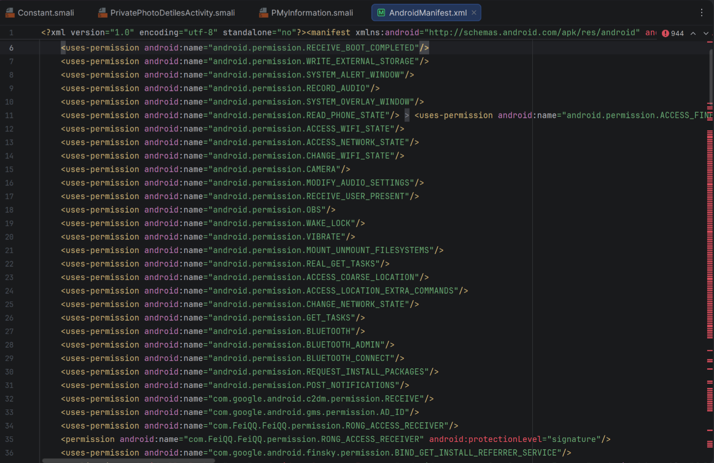
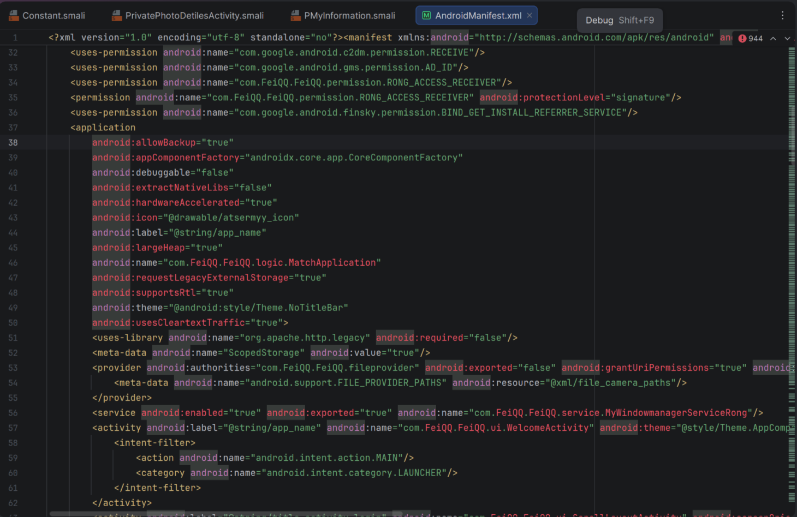
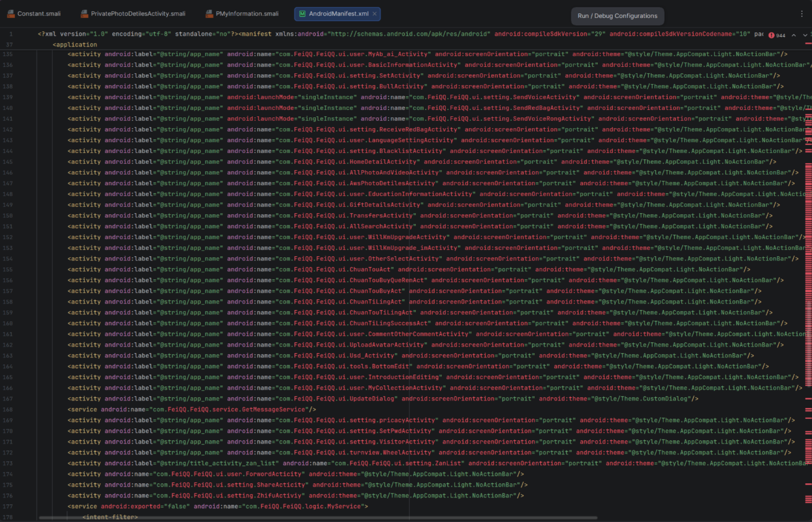
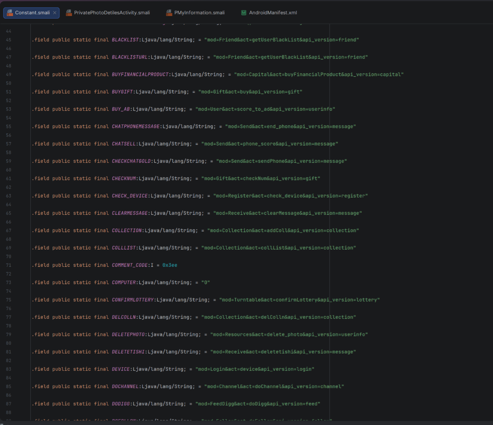
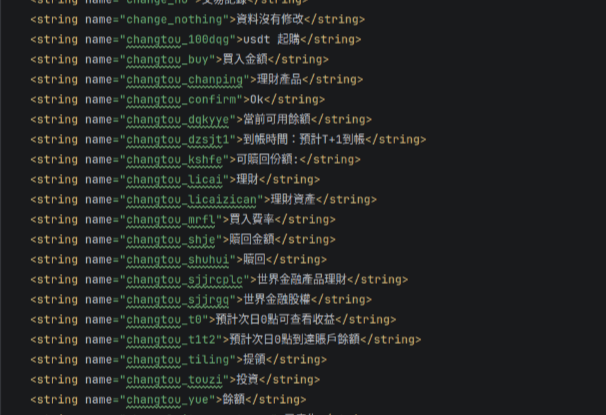
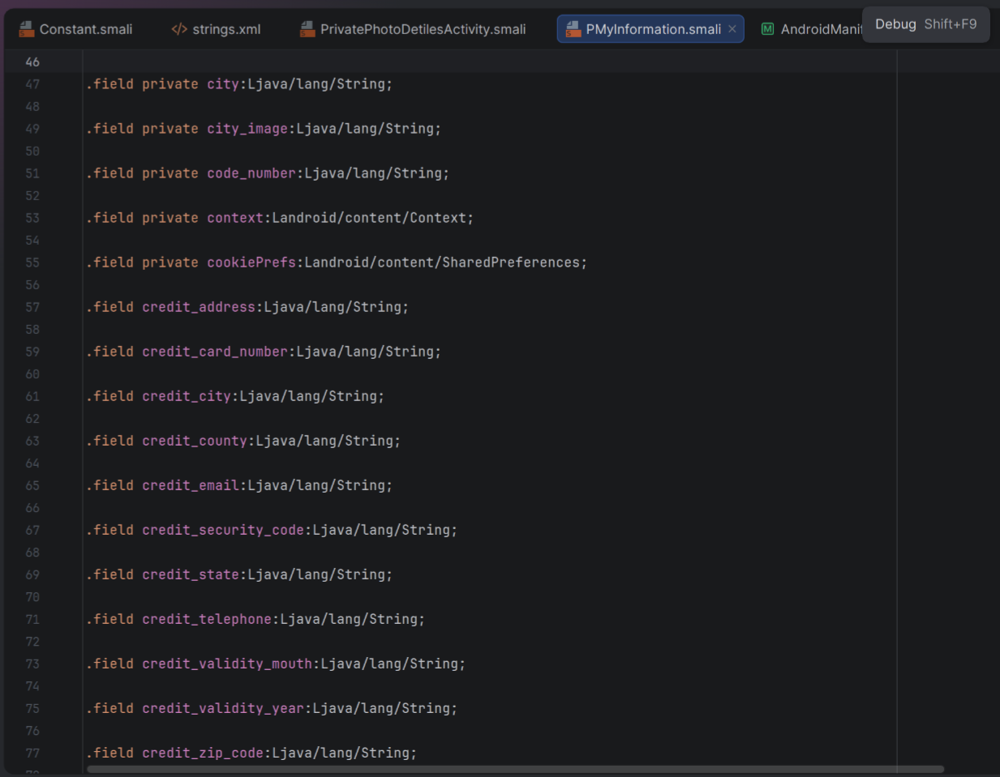

# AtsermyyRE
# Romance Scam APK Analysis — Pig Butchering (杀猪盘)

> **DISCLAIMER**
> This repository contains the results of **static analysis** of a suspicious Android application
> distributed via a romance scam. **The APK sample is NOT distributed here.** No malicious code,
> no hardcoded credentials, and no personal data are published.
> This material is provided for **educational and defensive purposes only**.
> If you received a similar APK — do not install it, do not run it, and report it.

---

## Executive Summary

An Android application (`com.FeiQQ.FeiQQ`) was received outside of any official app store
from a person met online, who then suggested installing it. The APK does not exist in
Google Play and has no legitimate publisher. Static analysis shows it is a **dating-themed
application with a hidden investment module** — a classic **pig butchering / romance scam**
pattern:

1. Trust is built through a dating interface (chat, video calls, gifts).
2. The victim is gradually pushed to "invest" USDT via the app.
3. Withdrawal is controlled by the operator's server and is effectively blocked.

The application also collects **full payment card data** and stores the user's
**password and AWS credentials in plaintext**.

---

## Sample Information

| Field | Value |
|---|---|
| Package name | `com.FeiQQ.FeiQQ` |
| SHA-256 | `2e9adbcfeb966e70029b4fead160c08b278276067466137973965fe97936a4c5` |
| VirusTotal | [https://www.virustotal.com/gui/file/2e9adbcfeb966e70029b4fead160c08b278276067466137973965fe97936a4c5] |
| Detection at time of check | 0/67 — *absence of signatures, not a proof of safety* |
| Distribution | Sent directly via messenger (not Google Play) |

---

## Manifest Analysis


*Dangerous permissions requested by the app.*

Key findings from `AndroidManifest.xml`:

- `MANAGE_EXTERNAL_STORAGE` — access to **all** files on the device, not just user-selected ones.
- `SYSTEM_ALERT_WINDOW` / `SYSTEM_OVERLAY_WINDOW` — draw overlays over other apps (clickjacking / phishing).
- `REQUEST_INSTALL_PACKAGES` — install additional APKs outside Google Play.
- `RECEIVE_BOOT_COMPLETED` — auto-start after reboot.
- `DISABLE_KEYGUARD` — dismiss the lock screen.
- `READ_PHONE_STATE`, `GET_TASKS`, `REAL_GET_TASKS` — device identifiers and running processes.
- `RECORD_AUDIO`, `CAMERA`, `ACCESS_FINE_LOCATION` — microphone, camera, precise location.


*Insecure settings: `allowBackup="true"`, `usesCleartextTraffic="true"`, `largeHeap="true"`.*

- `allowBackup="true"` — app data (including `SharedPreferences` with password and tokens) can be
  extracted via `adb backup`.
- `usesCleartextTraffic="true"` — HTTP without encryption is allowed.
- `exported="true"` on `MyWindowmanagerServiceRong` — the service is reachable from other apps.

---

## Hidden Investment Module


*Activities implementing the investment flow.*

The manifest contains a complete investment lifecycle that has nothing to do with dating:

- `ChuanTouAct` — investment (创投)
- `ChuanTouBuyAct`, `ChuanTouBuyQueRenAct` — purchase and confirmation
- `ChuanTiLingAct`, `ChuanTouTiLingAct`, `ChuanTiLingSuccessAct` — withdrawal flow
- `Usd_Activity` — USD/USDT operations
- `PayNew_Activity`, `PayStyle_Card_new_Activity`, `Pay_CountryActivity`,
  `RechargeActivity`, `JiaZhiActivity` — payment screens, including card payment

API endpoints (from `Constant.smali`) confirm the same flow:

```text
mod=Capital&act=getFinancialProducts
mod=Capital&act=buyFinancialProduct
mod=Capital&act=getUserInvestments
mod=Capital&act=redeemInvestment
mod=Capital&act=applyWithdraw
mod=Capital&act=getUserWithdrawLogs
mod=Capital&act=getUserCapitalInfo
```



*Investment API endpoints in `Constant.smali`.*


*Localized strings of the investment module (`usdt 起購`, `世界金融產品理財`, `Expected T+1 arrival`).*

The field `only_usdt` in `PMyInformation` indicates the app is designed to work
**only with USDT** — a common trait of pig butchering schemes, since crypto transfers
are hard to reverse.

---

## Data Collected and Stored Insecurely


*`PMyInformation` contains fields for full card data.*

The model `PMyInformation` includes:

- `credit_card_number`, `credit_validity_mouth` (sic), `credit_validity_year`,
  `credit_security_code` (CVV), `credit_zip_code`, `credit_address`,
  `credit_city`, `credit_state`, `credit_county`, `credit_telephone`, `credit_email`,
  `name_first`, `name_second`.

Additional issues:

- **Password** (`pass`) and **login** (`user`) are stored in plaintext in
  `SharedPreferences("MyInformation")`.
- **AWS credentials** (`osskey`, `osssecre`), **STS token** (`securityToken`),
  **API token** (`api_token_str`), **RongCloud token** (`rongImToken`) and
  **session id** are also stored there, unencrypted.
- `toString()` prints **all** fields, including password, card number and CVV —
  a leak risk if logged.


---

## Cloud Storage (AWS S3)


- The app obtains **temporary AWS credentials** from its own server
  (`mod=Upload&act=get_sts_token`).
- Uploads/downloads go to the S3 bucket `hk-attach`, region `ap-east-1`.
- Private photos are stored under the prefix `privatealbum`.
- "Private" user photos are therefore physically stored in the operator's S3 bucket,
  not on the device.

---

## API Authentication Weakness

API requests are signed as:

```text
api_token = MD5( mod + act + api_version + api_token_str )
```


This is a plain MD5 over a predictable concatenation, without a server-side secret.
If `api_token_str` leaks (and it is stored in plaintext on the device),
requests can be forged.

---

## Indicators of Compromise (IOCs)

> Defanged for safety.

- C2 domain: `opppi[.]com`
- API path: `https://www.opppi[.]com/api.php`
- S3 bucket: `hk-attach` (region `ap-east-1`)
- S3 prefix: `privatealbum`
- Support email: `Onlinedating999[.]@proton[.]me`
- SharedPreferences file: `MyInformation`
- IM provider: RongCloud (`io.rong.*`)
- Package name: `com.FeiQQ.FeiQQ`
- SHA-256: `2e9adbcfeb966e70029b4fead160c08b278276067466137973965fe97936a4c5`

---

## What Is NOT Published

For ethical and legal reasons, this repository does **not** contain:

- the APK sample itself;
- decompiled source code;
- working AWS Access Key ID / Secret Access Key;
- any personal data of real users.

Anyone who needs the sample for research should use the SHA-256 above to obtain it
through professional malware-sharing platforms (e.g. MalwareBazaar, VirusTotal).

---

## Recommendations

- Do **not** install APKs received from people you met online.
- If the app was already installed: do not top up any balance, remove the app,
  and change passwords used in it.
- Report the sample to the hosting provider of `opppi[.]com`, to AWS
  (`abuse@amazonaws[.]com`) and to the relevant law-enforcement authority.

---

## License / Contact

This write-up is released for educational use.
For questions or responsible disclosure — see `SECURITY.md`.
