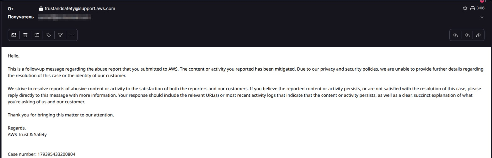

# AtsermyyRE
# Romance Scam APK Analysis — Pig Butchering (杀猪盘)

> **DISCLAIMER**
> This repository contains the results of **static analysis** of a suspicious Android application
> distributed via a romance scam. **The APK sample is NOT distributed here.** No malicious code,
> no hardcoded credentials, and no personal data are published.
> This material is provided for **educational and defensive purposes only**.
> If you received a similar APK — do not install it, do not run it, and report it.

---

## Executive Summary

An Android application (`com.FeiQQ.FeiQQ`) was received outside of any official app store
from a person met online, who then suggested installing it. The APK does not exist in
Google Play and has no legitimate publisher. Static analysis shows it is a **dating-themed
application with a hidden investment module** — a classic **pig butchering / romance scam**
pattern:

1. Trust is built through a dating interface (chat, video calls, gifts).
2. The victim is gradually pushed to "invest" USDT via the app.
3. Withdrawal is controlled by the operator's server and is effectively blocked.

The application also collects **full payment card data** and stores the user's
**password and AWS credentials in plaintext**.

---

## Sample Information

| Field | Value |
|---|---|
| Package name | `com.FeiQQ.FeiQQ` |
| SHA-256 | `2e9adbcfeb966e70029b4fead160c08b278276067466137973965fe97936a4c5` |
| VirusTotal | [Report](https://www.virustotal.com/gui/file/2e9adbcfeb966e70029b4fead160c08b278276067466137973965fe97936a4c5) |
| Detection at time of check | 1/66 — *flagged by BitDefenderFalx as `Android.Riskware.Repack.RMDV` (PUA). Note: initial scan showed 0/67, highlighting the delay in signature updates.* |
| Distribution | Sent directly via messenger (not Google Play) |
| Incident Date | October 19, 2026 (date of the scam attempt) |
| **Infrastructure Status** | **Mitigated by AWS (Case #179395433200804)** |

**Tooling used:** `jadx`, `apktool`, `Android Studio (Smali)`, `DNS propagation check`, `WHOIS`.

**Case Status:** Reported to AWS Trust & Safety. AWS confirmed that the malicious infrastructure (CloudFront/Route 53) has been **mitigated** (Case #179395433200804).

*Official confirmation from AWS Trust & Safety that the reported infrastructure was mitigated.*

---

## Manifest Analysis


*Dangerous permissions requested by the app.*

Key findings from `AndroidManifest.xml`:

- `MANAGE_EXTERNAL_STORAGE` — access to **all** files on the device, not just user-selected ones.
- `SYSTEM_ALERT_WINDOW` / `SYSTEM_OVERLAY_WINDOW` — draw overlays over other apps (clickjacking / phishing).
- `REQUEST_INSTALL_PACKAGES` — install additional APKs outside Google Play.
- `RECEIVE_BOOT_COMPLETED` — auto-start after reboot.
- `DISABLE_KEYGUARD` — dismiss the lock screen.
- `READ_PHONE_STATE`, `GET_TASKS`, `REAL_GET_TASKS` — device identifiers and running processes.
- `RECORD_AUDIO`, `CAMERA`, `ACCESS_FINE_LOCATION` — microphone, camera, precise location.


*Insecure settings: `allowBackup="true"`, `usesCleartextTraffic="true"`, `largeHeap="true"`.*

- `allowBackup="true"` — app data (including `SharedPreferences` with password and tokens) can be
  extracted via `adb backup`.
- `usesCleartextTraffic="true"` — HTTP without encryption is allowed.
- `exported="true"` on `MyWindowmanagerServiceRong` — the service is reachable from other apps.

---
### Exported Components (Attack Surface)

- **`com.FeiQQ.FeiQQ.ui.Topic_im_new_Activity`** — explicitly `exported="true"` with **no intent filter**. Any app on the device can launch this activity directly. This is a potential intent-redirection vector.
- **`com.FeiQQ.FeiQQ.service.MyWindowmanagerServiceRong`** — explicitly `exported="true"`. A window-management service reachable from other apps. In combination with `SYSTEM_ALERT_WINDOW`, this allows a third-party app to draw overlays over banking apps.
- **`io.rong.push.notification.RongBridgeActivity`** — exported, standard RongCloud bridge activity.
- **`com.google.firebase.iid.FirebaseInstanceIdReceiver`** — exported, protected by `com.google.android.c2dm.permission.SEND` (standard).

### Insecure Configuration Flags

- `android:allowBackup="true"` + **no `dataExtractionRules`** — all `SharedPreferences` (including plaintext password, AWS keys, API token) can be extracted via `adb backup`.
- `android:usesCleartextTraffic="true"` — HTTP without encryption is allowed.
- `android:requestLegacyExternalStorage="true"` + `MANAGE_EXTERNAL_STORAGE` — double bypass of Android 10+ scoped storage.
- `android:largeHeap="true"` — requested large heap (typical for media processing or hidden heavy activity).
- `android:debuggable="false"` — good, but doesn't protect against backup extraction.
- **`<queries>` block: not found** — the app does not declare package-visibility. It likely enumerates installed apps via `getInstalledPackages` (does not require `<queries>`) or via native code.

### Backup & Extraction Rules

| Attribute | Value |
|---|---|
| `allowBackup` | `true` |
| `fullBackupContent` | not found |
| `dataExtractionRules` | not found |
| `networkSecurityConfig` | not found |

## Hidden Investment Module


*Activities implementing the investment flow.*

The manifest contains a complete investment lifecycle that has nothing to do with dating:

- `ChuanTouAct` — investment (创投)
- `ChuanTouBuyAct`, `ChuanTouBuyQueRenAct` — purchase and confirmation
- `ChuanTiLingAct`, `ChuanTouTiLingAct`, `ChuanTiLingSuccessAct` — withdrawal flow
- `Usd_Activity` — USD/USDT operations
- `PayNew_Activity`, `PayStyle_Card_new_Activity`, `Pay_CountryActivity`,
  `RechargeActivity`, `JiaZhiActivity` — payment screens, including card payment

API endpoints (from `Constant.smali`) confirm the same flow:

```text
mod=Capital&act=getFinancialProducts
mod=Capital&act=buyFinancialProduct
mod=Capital&act=getUserInvestments
mod=Capital&act=redeemInvestment
mod=Capital&act=applyWithdraw
mod=Capital&act=getUserWithdrawLogs
mod=Capital&act=getUserCapitalInfo
```


*Investment API endpoints in `Constant.smali`.*


*Localized strings of the investment module (`usdt 起購`, `世界金融產品理財`, `Expected T+1 arrival`).*

The field `only_usdt` in `PMyInformation` indicates the app is designed to work
**only with USDT** — a common trait of pig butchering schemes, since crypto transfers
are hard to reverse.

---

## Data Collected and Stored Insecurely


*`PMyInformation` contains fields for full card data.*

The model `PMyInformation` includes:

- `credit_card_number`, `credit_validity_mouth` (sic), `credit_validity_year`,
  `credit_security_code` (CVV), `credit_zip_code`, `credit_address`,
  `credit_city`, `credit_state`, `credit_county`, `credit_telephone`, `credit_email`,
  `name_first`, `name_second`.

Additional issues:

- **Password** (`pass`) and **login** (`user`) are stored in plaintext in
  `SharedPreferences("MyInformation")`.
- **AWS credentials** (`osskey`, `osssecre`), **STS token** (`securityToken`),
  **API token** (`api_token_str`), **RongCloud token** (`rongImToken`) and
  **session id** are also stored there, unencrypted.
- `toString()` prints **all** fields, including password, card number and CVV —
  a leak risk if logged.


---

## Cloud Storage (AWS S3)

- The app obtains **temporary AWS credentials** from its own server
  (`mod=Upload&act=get_sts_token`).
- Uploads/downloads go to the S3 bucket `hk-attach`, region `ap-east-1`.
- Private photos are stored under the prefix `privatealbum`.
- "Private" user photos are therefore physically stored in the operator's S3 bucket,
  not on the device.

---

## API Authentication Weakness

API requests are signed as:

```text
api_token = MD5( mod + act + api_version + api_token_str )
```


This is a plain MD5 over a predictable concatenation, without a server-side secret.
If `api_token_str` leaks (and it is stored in plaintext on the device),
requests can be forged.

---

## MITRE ATT&CK Mapping

The observed behavior maps to the following MITRE ATT&CK techniques:

```markdown
- **T1626:** Abuse Elevation Control Mechanism (exported window-manager service)
- **T1516:** Input Injection (potential via `PHONE_CONTROL_USER` + `SYSTEM_ALERT_WINDOW`)
- **T1417:** Input Capture (fake investment forms capturing card data and CVV)
- **T1409:** Stored Application Data (credentials and tokens stored in plaintext SharedPreferences)
- **T1521:** Encrypted Channel (partially bypassed due to `usesCleartextTraffic="true"`)
- **T1584:** Compromise Infrastructure (usage of Amazon CloudFront/Route53 to hide C2)
- **T1428:** Exploitation for Client Execution (requesting `REQUEST_INSTALL_PACKAGES` for further payloads)
- **T1417.001:** Input Capture — Keylogging (WebView with JS enabled in `VisaWebActivity`)
- **T1539:** Steal Web Session Cookie (via WebView)


## OSINT Findings (Extracted Artifacts)

Static analysis of the decompiled code revealed direct links to the operators and their financial infrastructure:

- **Crypto Wallet (USDT TRC-20):** `TNPrZmfAiSMdYTV8kU4fcxDeErZWXGBXro` 
  *(Hardcoded in `Usd_Activity` for victim deposits. Trackable via Tronscan).*
- **Blockchain Activity:** The wallet has 4,335 lifetime transactions but has been **inactive for the last 180 days**. Historical interactions show direct transfers from **OKX exchange** (KYC-trail), indicating a burner address strategy where operators rotate wallets dynamically.
- **Operator Contact (Skype):** `yuan.zi4` 
  *(Hardcoded in `activity_fargot.xml` and `usd_layout.xml` as admin support).*
- **Email:** `Onlinedating999@proton.me`
- **Image CDN:** `http://image.opppi.com/`
### Hardcoded Payment Gateway (Homoglyph Domain)
### API Surface (Grouped by `mod`)

All requests go to `https://www[.]opppi[.]com/api.php` with fixed parameters `ap=2&client_id=1&abc=1`. Endpoints are grouped by `mod`:

| `mod` | Key `act` values | Purpose |
|---|---|---|
| `Login` | `doLogin`, `unLogin`, `device` | Auth |
| `Register` | `new_register`, `check_device`, `search_email` | Registration |
| `User` | `userInfo`, `updateHeadimg`, `ad_set`, `autoDenounce` | Profile, ads, **auto-denounce** |
| `Capital` | `getFinancialProducts`, `buyFinancialProduct`, `applyWithdraw`, `redeemInvestment` | **Investment module** |
| `Resources` | `photo`, `video`, `user_vault`, `valut_list`, `delete_photo` | Private photo vault |
| `Upload` | `get_sts_token`, `return_token`, `save_token`, `uploadImage` | S3 token exchange |
| `Send` | `sendText`, `sendImg`, `sendVoice`, `room`, `phone_score`, `sendPhone` | Chat & **paid phone calls** |
| `Receive` | `messageList`, `count`, `group_members` | Chat inbox |
| `Gift` | `gift`, `buy`, `checkNum`, `send` | Virtual gifts |
| `Follow` | `doFollow`, `unFollow`, `getfollow` | Social graph |
| `Feed` | `getfeed`, `addcomment`, `delfeed` | Feed |
| `Translate` | `language_to`, `special_language_to` | Translation |
| `Push` | `register`, `unbind` | FCM/RongCloud push |
| `WebMessage` | `pl`, `zan`, `atme` | Web notifications |

### Remote Phone Control Endpoint

`MyWindowmanagerServiceRong.smali:18` defines:

```text
PHONE_CONTROL_USER = "https://www[.]opppi[.]com/api.php?ap=2&client_id=1&abc=1&..."

This endpoint is named phone_control_user (under mod=Receive). Combined with the exported MyWindowmanagerServiceRong service and SYSTEM_ALERT_WINDOW permission, this is a potential remote-control / overlay-injection vector. The exact act value is not visible in the snippet, but the naming is self-explanatory.


Static analysis of `Base64Utils.smali` revealed a base64-encoded URL that decodes to:
https://0nlinepay[.]com/Payment/payConsoleNavi.aspx?order_id=2802101131145720

- **Homoglyph trick:** `0nlinepay` uses digit `0` instead of letter `o` to impersonate "onlinepay".
- **Purpose:** This is a separate payment-processing endpoint, distinct from `opppi[.]com`. Likely used for card-not-present transactions or a secondary cash-out channel.
- **Sample order ID:** `2802101131145720` (can be used as a pivot for OSINT).

### Weak Encryption & WebView Configuration

- **DES encryption** is used in `ChatActivity`, `ChatRongActivity`, and `GroupChatActivity` (`const-string v7, "des"`). DES is cryptographically broken (56-bit key) and unsuitable for protecting chat messages.
- **`VisaWebActivity`** enables `setJavaScriptEnabled(true)` and `setAllowFileAccess(true)` on its WebView. Combined with the "Visa" naming, this suggests a phishing screen for card data — a classic WebView-based credential harvester.
- **`AdvertWebActivity`** also enables JavaScript, loading URLs from intent extras (potential open redirect).

### Anti-Analysis: Not Detected

No root, emulator, Frida, Xposed, Magisk, QEMU, or `ptrace` checks were found in smali. This is unusual for banking trojans but consistent with **scamware** — the operators don't expect the victim to be a researcher, so they skip anti-analysis.

### Certificate Transparency & Subdomain Discovery
Analysis of Certificate Transparency logs (crt.sh) revealed the following subdomains and historical context:
- **Discovered Subdomains:** `www.opppi[.]com`, `image.opppi[.]com`, **`test.opppi[.]com`** (new IOC).
- **Timeline:** Certificates for `opppi[.]com` date back to **June 2022**, indicating long-term infrastructure usage.
- **CA History:** The operators used multiple Certificate Authorities (TrustAsia in 2022, Amazon in 2023-2025, Sectigo in 2026), likely to evade blocklists.

**Note on `test.opppi[.]com`:** A TLS certificate for this subdomain was issued on **2025-11-19** (Amazon RSA 2048 M01), but the DNS record **currently does not resolve** (confirmed via URLScan.io). This indicates the subdomain existed at some point (possibly a staging or admin panel) and was later removed — a common operational security practice to erase traces. The certificate, however, remains permanently in CT logs.

### AWS S3 Bucket Confirmation (via Wayback Machine)
Historical snapshots of `image.opppi[.]com` on the Wayback Machine revealed an **AWS S3 `AccessDenied` XML error**. 
- This confirms that `image.opppi[.]com` is a **custom domain mapped to an AWS S3 bucket**.
- The "AccessDenied" response means the bucket exists but public listing is blocked, corroborating the static analysis finding that user photos are stored in the `hk-attach` S3 bucket.

### Cloud & Infrastructure Keys (Redacted)
The application hardcodes several API keys used for its infrastructure. Values are partially redacted for ethical disclosure:

- **RongCloud App Key:** `n19jm...` *(Used for IM and video calls)*
- **AWS Access Key:** `AKIA...` *(Used for S3 bucket `hk-attach`)*
- **Firebase Project:** `ccatsov` 
  *(Firebase App ID: `1:4233...`, API Key: `AIza...`)*
- **AWS IP Check:** `https://checkip.amazonaws.com` *(Used to track victim's real IP)*

### Resources & Assets Analysis

Static review of `res/` and `assets/` revealed **no additional external endpoints or C2 domains** beyond `opppi[.]com` and `image.opppi[.]com`.

Key artifacts:

- **`assets/area.json`** — country/phone-code dictionary (Taiwan, US, Singapore, etc.). Used for registration country selection; not an IOC.
- **`assets/kurento_room_base64.cer`** — X.509 certificate for **Kurento** media server, issued in **2015 and expired in 2016**. This is a public/demo certificate from Kurento (open-source WebRTC media server), not operator-specific. Indicates the app reuses old WebRTC boilerplate.
- **`assets/gif/meme1.gif` … `meme56.gif`** — 56 generic GIF assets (UI stickers). No metadata or IOCs.
- **`res/raw/`** — audio files (`phone_s.mp3`, `phonevoice.mp3`, `prompt1.wav`, `rongphonevoice.aac`) and `firebase_common_keep.xml`. Audio files are voice-call ringtones/prompts; no embedded URLs.
- **No `.db`, `.sqlite`, `.jks`, `.keystore`, `.p12`, `.bks` files** were found in `res/` or `assets/`.

### Administrative / Test Strings

The resources contain admin/test UI strings, consistent with a reused dating-app template:

- `ad_admin_ad` — “advisory admin-Add a custom ad”
- `ad_admin_ad_ad` — “Custom ad serving”
- `ad_admin_ad_ai` — “Customized advertising, please consult:”
- `ball_system` — “Admin”
- `register_send_error` — “Transmission error, please contact the administrator”
- Test layout components: `com.FeiQQ.FeiQQ.utile.recordtest.RecordButton`, `com.FeiQQ.FeiQQ.utile.newtest.RefreshLayout`
- Test view IDs: `@id/tv_test_copy`, `@id/iv_test_copy`

**Note:** The absence of additional URLs in `assets/`/`res/` confirms that the C2 logic is implemented in code (`Constant.smali`, `AndroidHttpUtil`, etc.), not in resource files.

---

## Indicators of Compromise (IOCs)

> Defanged for safety.

- C2 domain: `opppi[.]com`
- Image domain: `image[.]opppi[.]com`
- Subdomain: `test.opppi[.]com` (historically active, cert issued 2025-11-19, currently no DNS record)
- USDT TRC-20 Wallet: `TNPrZmfAiSMdYTV8kU4fcxDeErZWXGBXro`
- Skype ID: `yuan.zi4`
- Support email: `Onlinedating999[.]@proton[.]me`
- S3 bucket: `hk-attach` (region `ap-east-1`)
- S3 prefix: `privatealbum`
- SharedPreferences file: `MyInformation`
- IM provider: RongCloud (`io.rong.*`)
- Package name: `com.FeiQQ.FeiQQ`
- SHA-256: `2e9adbcfeb966e70029b4fead160c08b278276067466137973965fe97936a4c5`
- Payment C2 domain: `0nlinepay[.]com` (homoglyph of "onlinepay"; hardcoded base64 in `Base64Utils.smali`)
- Payment API path: `https://0nlinepay[.]com/Payment/payConsoleNavi.aspx`
- Hardcoded `api_token`: `B13B-6D71-4EF5-88FA-F32781734A7F` (used in upload/S3 requests)

### APK Signing Certificate (Developer Identity)

Analysis of `META-INF/CERT.RSA` reveals the signing certificate used to build this APK:

- **Subject/Issuer:** `C=AR, ST=Argentina, L=Buenos Aires, O=Tiendanube, OU=Tiendanube, CN=otomasse`
- **Validity:** Sep 15, 2026 – Aug 22, 2126 (issued for 100 years — highly unusual)
- **SHA-256:** `AD:D0:0E:3B:31:AA:43:3B:B1:01:7D:7A:73:97:20:56:45:55:C9:7B:FB:C6:58:62:FB:D8:FE:D4:C9:68:5B:43`
- **SHA-1:** `97:EA:B9:34:83:1A:1E:9A:58:DB:36:78:EC:6E:2A:3C:47:71:FE:86`

**OSINT Note:** The operators spoofed **Tiendanube** — the largest e-commerce platform in Latin America (HQ in Buenos Aires). This explains why the app's Terms of Service mention *"Argentine law"* as the governing jurisdiction. The certificate was issued on **September 15, 2026** — one month before the scam attempt, indicating fresh infrastructure built specifically for this campaign.

### OSINT Verification Status

To ensure the accuracy of the extracted indicators, several external checks were performed:

- **APK Certificate SHA-256:** Queried on VirusTotal. Result: **No matches found** (indicates a unique keystore, likely generated specifically for this campaign or not yet indexed by AV engines).
- **Firebase Project (`ccatsov`):** Checked `ccatsov.firebaseio.com/.json`. Result: **404 Not Found** (indicates the Realtime Database is either disabled or does not exist; the project likely only uses FCM for push notifications).
- **Skype ID (`yuan.zi4`):** Searched via Google and public databases. Result: **No public scam reports or correlations found at the time of check.**

### Dropper / Self-Update Capability

`WelcomeActivity` contains a downloader that fetches an APK from the C2 (`opppi.com`) and silently installs it:

- Downloads to `/sdcard/download/` via `HttpURLConnection`
- Uses intent `application/vnd.android.package-archive` with `FLAG_ACTIVITY_NEW_TASK`
- Requires `REQUEST_INSTALL_PACKAGES` (declared in manifest)
- This is a classic **Dropper** pattern — the app can push new malware (banking trojan, ransomware) post-install, bypassing Google Play review.

**Additional indicator:** App targets `targetSdkVersion=29` (Android 10) deliberately to bypass modern scoped-storage and permission restrictions.

## Detection & Hunting

To detect this specific campaign or similar threats:

**Network:**
- Look for outbound HTTP/HTTPS requests to `opppi[.]com` or CloudFront distributions resolving to `djd3j8k4vp1a5.cloudfront.net`.
- Monitor for POST requests to `/api.php` with parameters starting with `mod=Capital&act=`.

**Endpoint (Android):**
- Search for the presence of the package `com.FeiQQ.FeiQQ`.
- Check `SharedPreferences("MyInformation")` for plaintext keys like `credit_card_number` or `osskey`.

## YARA Rule

To detect this specific campaign or similar threats, the following YARA rule can be used. It is based on unique strings identified during static analysis.

```yara
rule RomanceScam_FeiQQ_APK {
    meta:
        description = "Detects FeiQQ romance scam APK based on static analysis artifacts"
        author = "aalmaz1"
        date = "2026-11-06"
        reference = "https://github.com/aalmaz1/AtsermyyRE"
        hash = "2e9adbcfeb966e70029b4fead160c08b278276067466137973965fe97936a4c5"
    strings:
        $s1 = "com.FeiQQ.FeiQQ" ascii wide
        $s2 = "mod=Capital&act=buyFinancialProduct" ascii wide
        $s3 = "changtou_sjjrcplc" ascii wide
        $s4 = "Onlinedating999@proton.me" ascii wide
    condition:
        uint32(0) == 0x04034b50 and 2 of them
}
```


## What Is NOT Published

For ethical and legal reasons, this repository does **not** contain:

- the APK sample itself;
- decompiled source code;
- working AWS Access Key ID / Secret Access Key;
- any personal data of real users.

Anyone who needs the sample for research should use the SHA-256 above to obtain it
through professional malware-sharing platforms (e.g. MalwareBazaar, VirusTotal).

---

## Recommendations

- Do **not** install APKs received from people you met online.
- If the app was already installed: do not top up any balance, remove the app,
  and change passwords used in it.
- Report the sample to the hosting provider of `opppi[.]com`, to AWS
  (`abuse@amazonaws[.]com`) and to the relevant law-enforcement authority.

---

## License / Contact

This write-up is released for educational use.
For questions or responsible disclosure — see `SECURITY.md`.
