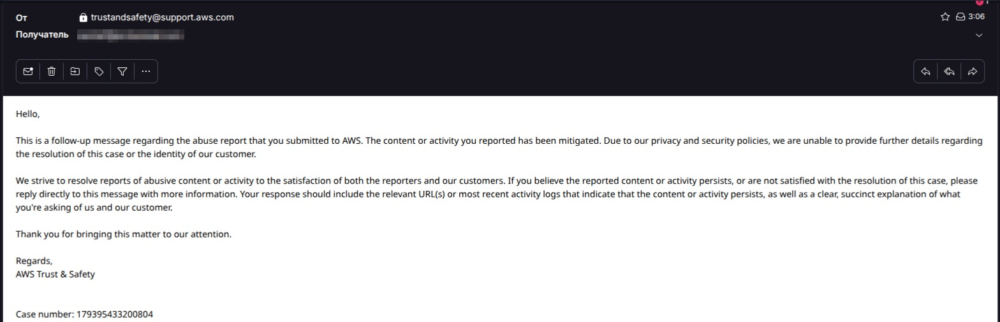
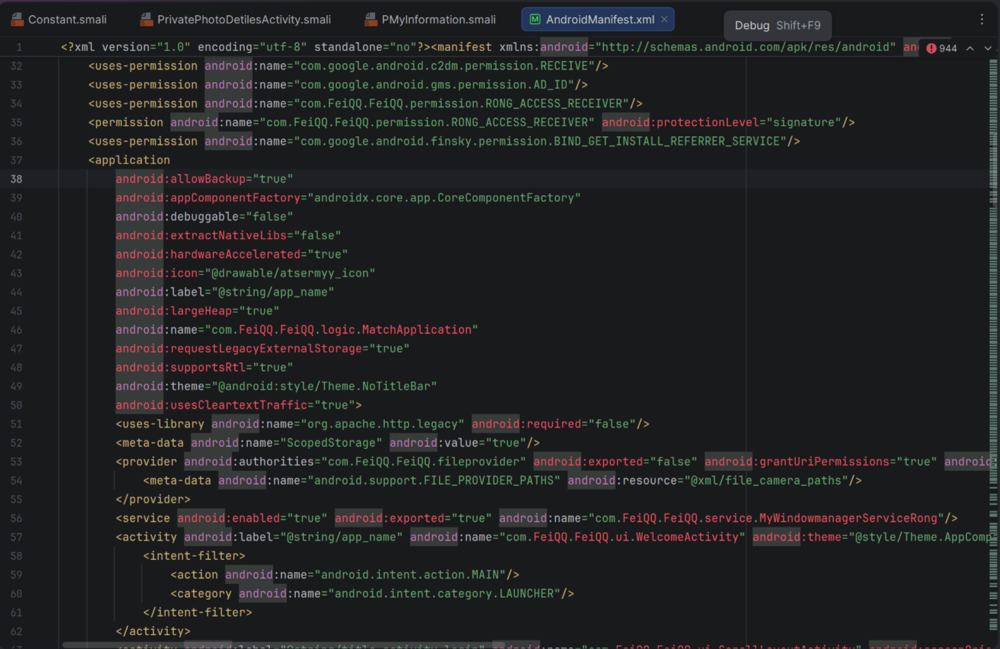
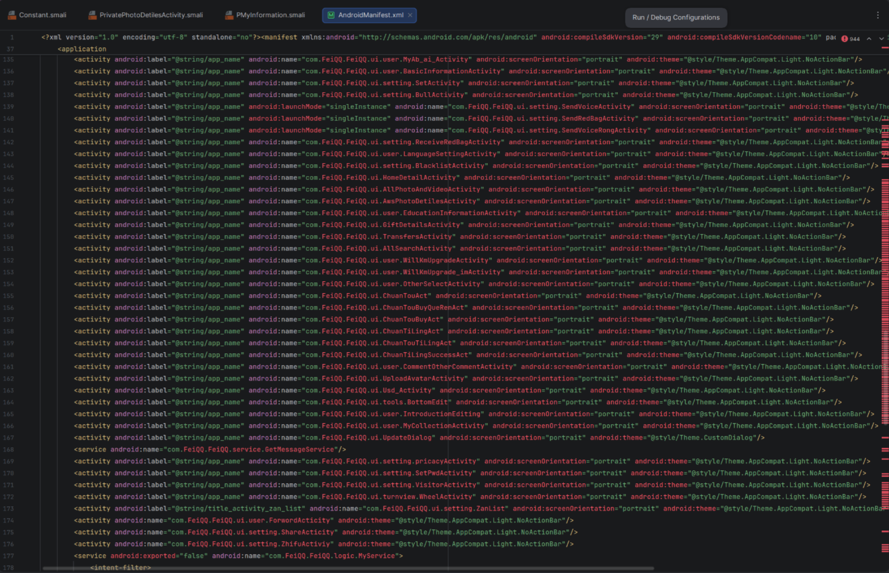
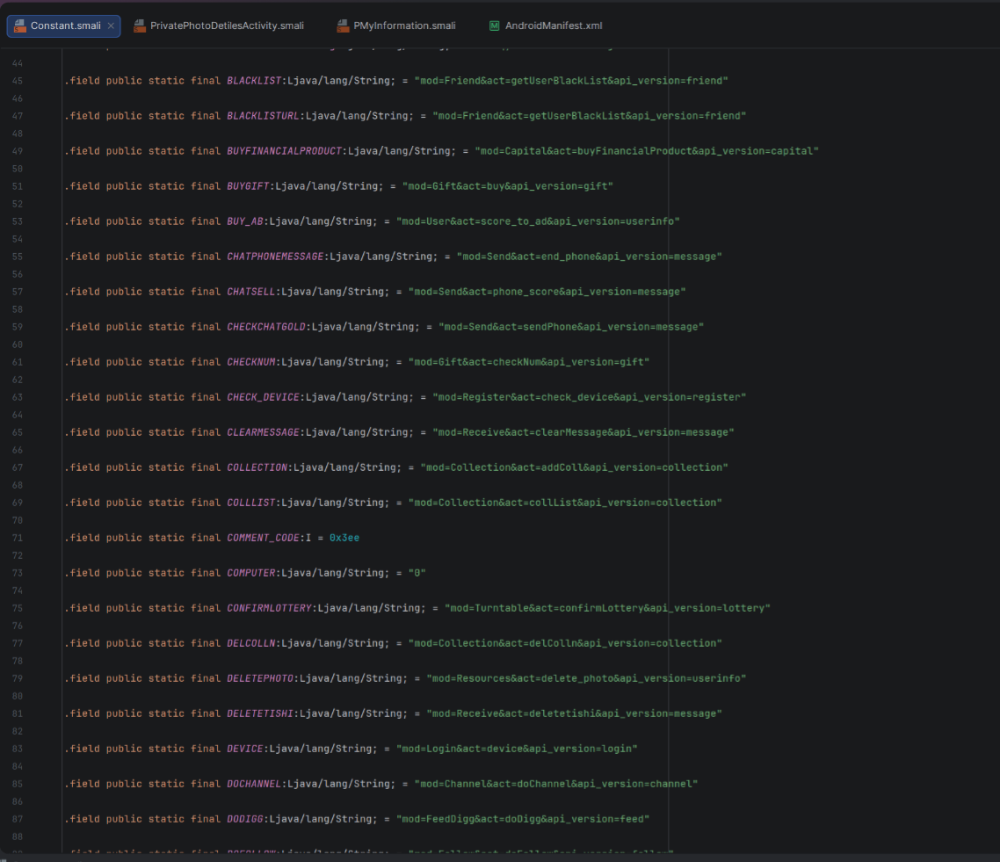
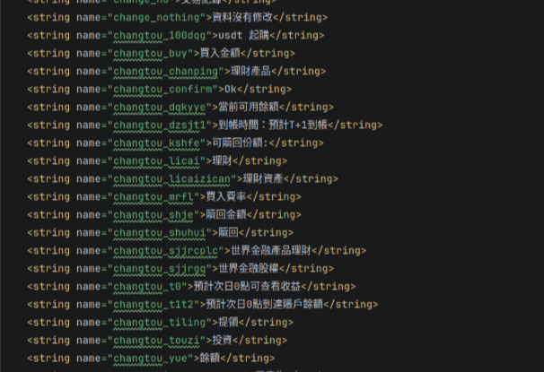
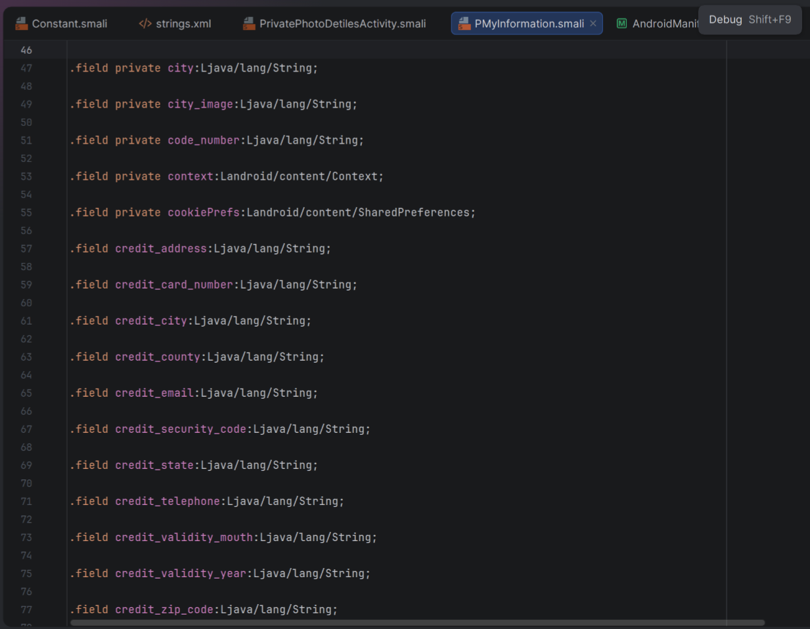

# AtsermyyRE
# Romance Scam APK Analysis — Pig Butchering (杀猪盘)

> **DISCLAIMER:**
> This repository contains the results of **static analysis** of a suspicious Android application
> distributed via a romance scam. **The APK sample is NOT distributed here.**
> No complete working secrets, full credential values, or personal data are published.
> Some infrastructure identifiers and token fragments are partially redacted.
> This material is provided for **educational and defensive purposes only**.
> If you received a similar APK — do not install it, do not run it, and report it.

---

## Executive Summary

An Android application (`com.FeiQQ.FeiQQ`) was received outside an official app store from a person met online who subsequently encouraged its installation.

Static analysis identified a dating-themed application containing an integrated cryptocurrency investment and payment module. The combination of online relationship-building features, USDT-related investment functionality, and financial operations is consistent with patterns associated with **romance-investment scams (pig butchering)**.

The following functionality was identified:

1. Dating and communication features, including chat, video calls, and virtual gifts.
2. Investment-related functionality involving USDT and financial products.
3. Backend API operations for purchasing financial products, managing investments, and requesting withdrawals.
4. Collection and storage of certain account and contact information, including plaintext login credentials in application SharedPreferences. Additional authentication-related values are present in the application's data model, but their persistence must be assessed individually.
5. A secondary APK download and installation mechanism, subject to Android installation controls.

**Payment card analysis:** Static analysis identified a dating-themed application containing integrated USDT-related investment and payment functionality. The payment click handler reads these fields and invokes Base64 encoding, but the encoded return values are not captured. No code path populating these fields, persisting their values, or adding them to the examined payment request was identified. The payment request includes the cardholder name, phone number, and the value from `et_name_182` under the parameters `name`, `phone`, and `email`, respectively. The available evidence does not establish that PAN or CVV values are collected or transmitted through these fields.

The application communicates with backend infrastructure associated with `opppi[.]com` and uses third-party services, including RongCloud and AWS infrastructure.

**Assessment:** The APK exhibits functionality and infrastructure consistent with a suspected romance-investment scam. This assessment is based on static analysis of the application and available infrastructure artifacts; it does not independently establish the identity of the operators or the outcome of every financial transaction.

---

## Sample Information

| Field | Value |
|---|---|
| Package name | `com.FeiQQ.FeiQQ` |
| SHA-256 | `2e9adbcfeb966e70029b4fead160c08b278276067466137973965fe97936a4c5` |
| VirusTotal | [Report](https://www.virustotal.com/gui/file/2e9adbcfeb966e70029b4fead160c08b278276067466137973965fe97936a4c5) |
| Detection at time of check | 1/66 — *flagged by BitDefenderFalx as `Android.Riskware.Repack.RMDV` (PUA). An earlier scan showed 0/67. Scan results and engine counts may change over time.* |
| Reported distribution | Sent directly via messenger (not Google Play) |
| Incident Date | October 19, 2026 (date of the scam attempt) |
| **Infrastructure Status** | AWS confirmed mitigation of the reported CloudFront and Route 53 resources (Case #179395433200804) |

**Tooling used:** `jadx`, `apktool`, `Android Studio (Smali)`, `DNS propagation check`, `WHOIS`.

**Case Status:** Reported to AWS Trust & Safety. AWS confirmed that the reported CloudFront and Route 53 resources were mitigated under Case #179395433200804. This confirmation does not independently establish that all infrastructure associated with the application has been removed.

*Official confirmation from AWS Trust & Safety that the reported infrastructure was mitigated.*

---

## Manifest Analysis


*Dangerous permissions requested by the app.*

Key findings from `AndroidManifest.xml`:

- `MANAGE_EXTERNAL_STORAGE` — requests broad access to shared storage. Declaring this permission does not establish that the user granted the required special access or that the application actually accessed all shared files.
- `SYSTEM_ALERT_WINDOW` — real Android special permission associated with drawing overlays over other apps. Actual overlay capability depends on the applicable Android version and whether the required special access has been granted. Overlay functionality can create clickjacking or phishing risks.
- `SYSTEM_OVERLAY_WINDOW` — not a standard Android platform permission name. Its declaration alone does not establish any additional overlay capability. Whether it is also declared as a custom application permission should be checked before concluding that Android ignores it entirely.
- `REQUEST_INSTALL_PACKAGES` — allows the application to request installation of additional packages. Actual installation remains subject to Android's package-installation controls, including applicable unknown-source authorization and user interaction.
- `RECEIVE_BOOT_COMPLETED` — allows the application to receive the boot-completed broadcast. Automatic startup depends on the presence and implementation of a corresponding receiver.
- `DISABLE_KEYGUARD` — legacy permission associated with controlling keyguard behavior. Its presence does not prove that the application can bypass a secure device lock screen.
- `READ_PHONE_STATE` — requests access to certain phone-state information. The exact data available depends on the Android version, granted permissions, and application implementation.
- `REAL_GET_TASKS` (signature|privileged) and `GET_TASKS` (deprecated since API 21) are
  **declared but not grantable to third-party apps on modern Android**. They may only matter
  on very old devices / legacy APIs. Their presence is suspicious, but it does not by itself
  prove access to running processes.
- `RECORD_AUDIO`, `CAMERA`, `ACCESS_FINE_LOCATION` — microphone, camera, precise location.


*Insecure settings: `allowBackup="true"`, `usesCleartextTraffic="true"`, `largeHeap="true"`.*

- `allowBackup="true"` — enables Android backup behavior where supported. It does not by itself prove that application data can be extracted through `adb backup`; actual backup behavior depends on Android version, backup transport, device policy, and backup rules.
- `usesCleartextTraffic="true"` — HTTP without encryption is allowed.
- `exported="true"` on `MyWindowmanagerServiceRong` — exposes the
  service to potential interaction from other applications, subject
  to its permission requirements and implementation-level access checks.

### Exported Components (Attack Surface)

- **`com.FeiQQ.FeiQQ.ui.Topic_im_new_Activity`** — explicitly `exported="true"` with no intent filter. Other applications may be able to launch this activity explicitly, subject to Android component access rules. This creates an externally reachable activity surface; an intent-redirection vulnerability has not been demonstrated.

- **`com.FeiQQ.FeiQQ.service.MyWindowmanagerServiceRong`** — explicitly `exported="true"`. This exposes the service to potential external interaction, subject to its actual access checks and implementation. The presence of `SYSTEM_ALERT_WINDOW` indicates that overlay functionality may be relevant, but the ability of another application to use this service to display overlays over banking applications has not been demonstrated.

- **`io.rong.push.notification.RongBridgeActivity`** — exported RongCloud bridge activity.

- **`com.google.firebase.iid.FirebaseInstanceIdReceiver`** — exported receiver protected by `com.google.android.c2dm.permission.SEND`.

### Insecure Configuration Flags

- `android:allowBackup="true"` — enables Android backup behavior where supported. Because no explicit backup-exclusion configuration was identified, application data may be included in backups depending on Android version, backup transport, device policy, and other platform restrictions. Extraction through `adb backup` was not independently demonstrated.
- `android:usesCleartextTraffic="true"` — permits cleartext network traffic under the applicable Android network security configuration. This setting alone does not prove that the application actually transmits data over HTTP.
- `android:requestLegacyExternalStorage="true"` — requests legacy external-storage behavior on supported Android versions. Its effect depends on the Android version and target SDK; it should not be described as a permission bypass.
- `android:largeHeap="true"` — requests a larger application heap. This is not evidence of malicious behavior by itself.
- `android:debuggable="false"` — indicates that the application is not configured as debuggable in its manifest.

No `fullBackupContent`, `dataExtractionRules`, or `networkSecurityConfig` declaration was identified in the examined manifest.

### Backup & Extraction Rules

| Attribute | Value |
|---|---|
| `allowBackup` | `true` |
| `fullBackupContent` | not found |
| `dataExtractionRules` | not found |
| `networkSecurityConfig` | not found |

---

## Hidden Investment Module


*Activities implementing the investment flow.*

The manifest and associated application code identify a dedicated
investment-related module separate from the dating and communication
features.

- `ChuanTouAct` — investment (创投)
- `ChuanTouBuyAct`, `ChuanTouBuyQueRenAct` — purchase and confirmation
- `ChuanTiLingAct`, `ChuanTouTiLingAct`, `ChuanTiLingSuccessAct` — withdrawal flow
- `Usd_Activity` — USD/USDT operations
- `PayNew_Activity`, `PayStyle_Card_new_Activity`, `Pay_CountryActivity`,
  `RechargeActivity`, `JiaZhiActivity` — payment screens, including card payment

API endpoints (from `Constant.smali`) confirm the same flow:

```text
mod=Capital&act=getFinancialProducts
mod=Capital&act=buyFinancialProduct
mod=Capital&act=getUserInvestments
mod=Capital&act=redeemInvestment
mod=Capital&act=applyWithdraw
mod=Capital&act=getUserWithdrawLogs
mod=Capital&act=getUserCapitalInfo
```


*Investment API endpoints in `Constant.smali`.*


*Localized strings of the investment module (`usdt 起購`, `世界金融產品理財`, `Expected T+1 arrival`).*

The only_usdt field in PMyInformation suggests that the application supports or configures a USDT-specific operating mode. Its exact effect depends on where and how this field is consumed.

---

## Sensitive Data Handling and Storage



### Payment Form Fields and Payment API Request

Static analysis of `PayNew_Activity.smali`, `PayNew_Activity$myOnClick.smali`, and the payment form layout identified several payment-related fields. The field names and UI hints alone are not sufficient to establish that all of them contain card data.

**1. Identified payment form fields**

| UI field | Observed purpose / characteristics |
|---|---|
| `et_name_72` | Visible EditText used as the cardholder name field |
| `et_name_92` | Hidden integer-input EditText with hint `1`; likely intended for PAN |
| `et_name_142` | Hidden integer-input EditText with hint `111` and maximum length 3; likely intended for CVV/CVC |
| `et_name_122`, `et_name_123` | TextViews associated with expiry month/year selection |
| `et_name_162` | Phone number |
| `et_name_182` | Input value added to the HTTP parameter `email`; the exact UI meaning (email or ZIP-related input) requires confirmation |
| `et_name_222` | Hidden form field; postal-code purpose not independently verified |

The PAN-like and CVV-like fields are declared in `PayNew_Activity` and initialized using `findViewById()`. Their parent containers are marked `visibility="gone"` in the examined layout.

**2. PAN/CVV field handling**

The payment click handler reads `et_name_92` and `et_name_142` using `getText().toString()`, converts the strings to byte arrays, and invokes `Base64.encodeToString()`.

However, the return values of these Base64 calls are not captured by the caller. No subsequent use of the encoded values was identified in the examined handler.

The examined code did not reveal a population path for these two fields, nor did the reviewed request-construction or persistence paths show their values being stored or submitted.

The XML hints (`1` and `111`) are placeholders, not initial field values. The available static evidence therefore does not establish that PAN or CVV/CVC values are actually collected or transmitted through these fields.

**3. Payment API request construction**

The payment handler constructs an `AbRequestParams` object and adds the following parameters:

| HTTP parameter | Source | Observed meaning |
|---|---|---|
| `email` | `et_name_182` | Value taken from the corresponding form field; the parameter is named `email` |
| `phone` | `et_name_162` | Phone number |
| `name` | `et_name_72` | Cardholder name |
| `uid` | `PMyInformation.getUid()` | User identifier |
| `ip` | `PayNew_Activity.line_ip` | Value obtained from an external IP-check service |
| `from` | Constant `"2"` | Application-defined parameter |
| `type` | Constant `"3"` | Application-defined parameter |
| `charge_value` | `PayNew_Activity.gold_num` | Payment/top-up amount |
| `deviceName` | `android.os.Build.MODEL` | Android device model |
| `client` | `PMyInformation.getUid()` | Same getter/source as `uid` |
| `api_token` | Computed in `setWeb()` | Request authentication-related parameter |

The request is passed through this call chain:

`PayNew_Activity$myOnClick.onClick()` → `access$1800()` → `setWeb()` → `AbHttpUtil.post()`.

The endpoint is:

`https://www[.]opppi[.]com/api.php?ap=2&client_id=1&abc=1&mod=Pay&act=pay&api_version=pay`

This establishes that the application prepares these parameters and passes them to its HTTP client's POST method. Static analysis alone does not prove successful network transmission, server receipt, processing, or retention.

**4. Public IP lookup**

`PayNew_Activity.onCreate()` starts a background thread that requests `https://checkip.amazonaws.com`. The response is read and assigned to `PayNew_Activity.line_ip`, which is later added to the payment request as the `ip` parameter.

Because the lookup runs asynchronously and the examined handler does not validate `line_ip` before adding it to the request, an early payment-button tap could result in a null or empty value. This is a possible timing condition, not a confirmed runtime outcome.

The value represents the public egress IP observed by the external service, which may differ from a device's local IP and can be affected by NAT, VPNs, or proxies.

**Assessment**

The examined payment flow confirms submission of a cardholder name, phone number, the value from et_name_182, submitted under the parameter name email, user identifier, IP-check result, device model, payment amount, and additional application-defined parameters to the payment API.

It also confirms that the handler reads two hidden fields apparently intended for PAN and CVV/CVC and invokes Base64 encoding on their contents. However, the encoded results are not captured, and no corresponding PAN/CVV persistence or request-parameter flow was identified in the examined code.

Accordingly, the available evidence does not establish that this payment handler successfully collects, stores, or transmits PAN or CVV/CVC values.

### PMyInformation Data Model

The separate `PMyInformation.smali` class declares fields associated with payment information:

- `credit_card_number`
- `credit_validity_mouth`
- `credit_validity_year`
- `credit_security_code`
- `credit_zip_code`
- `credit_address`
- `credit_city`
- `credit_state`
- `credit_county`
- `credit_telephone`
- `credit_email`
- `name_first`
- `name_second`

The class also contains a SharedPreferences reference. However, the
identified payment handler does not use these model fields to construct
the examined payment request.

Although the handler reads two hidden PAN-like and CVV/CVC-like form
fields and invokes Base64 encoding, no corresponding persistence or
request-parameter flow was identified in the examined code.

The presence of these fields in the PMyInformation data model does not
by itself establish that card data is populated, stored, or transmitted.

### Other Sensitive Application Data

Additional analysis of `PMyInformation.smali` identified storage of:

- **Password** (`pass`) and **login** (`user`) in plaintext in `SharedPreferences("MyInformation")`.
- **Authentication-related values:** the `PMyInformation` model contains fields for AWS-related values (`osskey`, `osssecre`, `securityToken`), API token material (`api_token_str`), RongCloud token (`rongImToken`), and session-related data. The inspected AWS setters only assign values in memory; persistent storage of these AWS credentials through those setters was not identified.

- **Plaintext account credentials:** the application stores the account login (`user`) and password (`pass`) in `SharedPreferences("MyInformation")`.

The `toString()` implementation includes payment-related fields and other sensitive model values. This creates a potential exposure risk if populated instances are logged. Actual logging of populated card data has not been established.

---

## Cloud Storage (AWS S3)

The application requests AWS-related credentials from its backend through the
`Upload/get_sts_token` API endpoint.

The inspected response handler parses the JSON response and extracts:
- `AccessKeyId`
- `AccessKeySecret`
- `SecurityToken`
- `Expiration`

The access key ID and secret key are assigned to fields in
`AwsPhotoDetilesActivity` and passed to the application's `PMyInformation`
model. The inspected setters (`setOsskey`, `setOsssecre`, and
`setSecurityToken`) only assign in-memory fields. No SharedPreferences or
SQLite persistence was identified in these setter implementations.

The examined S3 upload client is constructed using
`BasicAWSCredentials(String accessKeyId, String secretKey)`.
The `SecurityToken` extracted from the backend response is not passed
to this constructor.

The examined upload path uses:
- Bucket: `hk-attach`
- Region: `ap-east-1`
- Object key: value obtained from `fileStr`
- Local file: `File(fileStr)`

The code subsequently constructs a `PutObjectRequest` and invokes
`AmazonS3.putObject()`.

**Security observation:** If the backend supplies temporary AWS STS
credentials, the examined client construction does not provide the
associated session token through the credentials object. AWS temporary
credentials normally require the session token for authenticated requests.
Therefore, the inspected implementation appears incompatible with
temporary STS credentials unless another session-token mechanism is involved.

Static analysis confirms the presence of the upload call, but does not
independently establish successful uploads, successful AWS authentication,
or server-side storage.

No S3 download implementation was identified in the examined code.
The string `privatealbum` was found, but its use as the object key or
an S3 prefix was not established.

---

## Client-Side API Token Generation (MD5)

The client computes the `api_token` request parameter using MD5.

For the examined payment endpoint:

`https://www[.]opppi[.]com/api.php?ap=2&client_id=1&abc=1&mod=Pay&act=pay&api_version=pay`

The inspected Smali code extracts the values `Pay` and `pay` from the URL, concatenates them without a separator, appends `api_token_str` retrieved from the `PMyInformation` data model, and calculates the MD5 digest:

```text
api_token = MD5("Paypay" + api_token_str)
```

The value `api_token_str` is retrieved from the application's `PMyInformation` data model.

This is an MD5-based client-side calculation, not HMAC-MD5 or encryption. The application contains the logic and token material needed to calculate this request parameter locally.

Whether modified or forged requests are accepted depends on server-side validation. The server-side authentication implementation has not been independently examined.

## 🎯 MITRE ATT&CK for Mobile — Preliminary Mapping

The following is a preliminary mapping of observed application behavior to MITRE ATT&CK for Mobile. Technique applicability depends on the demonstrated behavior, not merely on manifest permissions or the presence of related API calls.

| Tactic | Technique ID | Technique Name | Evidence in APK |
| :--- | :--- | :--- | :--- |
| **Initial Access** | **[T1476](https://attack.mitre.org/techniques/T1476/)** | Deliver Malicious App via Other Means | The reported incident involved direct delivery of the APK through a messenger rather than an official app store. This mapping is based on the reported delivery method, not on an installation mechanism identified in the APK itself. |

---

## OSINT Findings (Extracted Artifacts)

Static analysis of the decompiled code revealed hardcoded contact
details, a USDT-related wallet address, and infrastructure indicators
associated with the application:

- **Crypto Wallet (USDT TRC-20):** `TNPrZmfAiSMdYTV8kU4fcxDeErZWXGBXro`
  *(Hardcoded in `Usd_Activity` as a USDT-related wallet address. Its exact role in completed transactions has not been independently established.)*
- **Blockchain Activity:** At the time of the blockchain check, the address showed 4,335 lifetime transactions and no activity during the preceding 180 days. Historical transactions included transfers associated with OKX-labeled addresses. These observations do not identify the wallet owner or establish a wallet-rotation strategy.
- **Operator Contact (Skype):** `yuan.zi4` 
  *(Hardcoded in `activity_fargot.xml` and `usd_layout.xml` as admin support).*
- **Email:** `Onlinedating999[@]proton[.]me`
- **Image CDN:** `hxxp://image[.]opppi[.]com/`

### Additional Hardcoded URL

Static analysis of `Base64Utils.smali` revealed a Base64-encoded URL:

`hxxps://0nlinepay[.]com/Payment/payConsoleNavi.aspx?order_id=2802101131145720`

- **Visual substitution:** The domain uses digit `0` instead of the letter `o`.
- **Purpose:** The URL is embedded in the application, but its exact operational role and relationship to the `opppi[.]com` payment API have not been independently established.
- **Sample order ID:** `2802101131145720`. Its validity and association with an actual transaction have not been established.

### API Surface (Grouped by `mod`)

The application-specific API endpoints identified in the examined
application code use the following base URL:

`hxxps://www[.]opppi[.]com/api.php`

The application also references third-party infrastructure and
services, including AWS and RongCloud.

| `mod` | Key `act` values | Purpose |
|---|---|---|
| `Login` | `doLogin`, `unLogin`, `device` | Auth |
| `Register` | `new_register`, `check_device`, `search_email` | Registration |
| `User` | `userInfo`, `updateHeadimg`, `ad_set`, `autoDenounce` | Profile, ads, **auto-denounce** |
| `Capital` | `getFinancialProducts`, `buyFinancialProduct`, `applyWithdraw`, `redeemInvestment` | **Investment module** |
| `Resources` | `photo`, `video`, `user_vault`, `valut_list`, `delete_photo` | Photo, video, and user-vault operations |
| `Upload` | `get_sts_token`, `return_token`, `save_token`, `uploadImage` | S3-related credential and upload operations |
| `Send` | `sendText`, `sendImg`, `sendVoice`, `room`, `phone_score`, `sendPhone` | Chat and phone-call-related operations |
| `Receive` | `messageList`, `count`, `group_members` | Chat inbox |
| `Gift` | `gift`, `buy`, `checkNum`, `send` | Virtual gifts |
| `Follow` | `doFollow`, `unFollow`, `getfollow` | Social graph |
| `Feed` | `getfeed`, `addcomment`, `delfeed` | Feed |
| `Translate` | `language_to`, `special_language_to` | Translation |
| `Push` | `register`, `unbind` | FCM/RongCloud push |
| `WebMessage` | `pl`, `zan`, `atme` | Web notifications |

### `phone_control_user` Endpoint and Floating Window

The application defines and uses a backend endpoint named `phone_control_user` under `mod=Receive`.

The inspected response listener parses the server response into an `AllMsgVo` object and reads its `code` field:

- `700`: sets the service state to `freeman`.
- `704`: sets the state to `notfreeman` and sends message `0x16e` to `changeImageHandler`.
- Other response codes: also set the state to `notfreeman` and send message `0x16e`.

The inspected portion of the `0x16e` branch in `MyWindowmanagerServiceRong$1.handleMessage()` checks the user's `sex` value and invokes `deductgold()` when it is not equal to `"2"`. The preceding portion of the branch was not included in the supplied excerpt, so additional conditions before this check cannot be ruled out.

The examined `0x16e` branch does not show modifications to floating-window Views, window coordinates, dimensions, visibility, or `WindowManager.LayoutParams`.

**Assessment:** The examined endpoint response is associated with application account/service-status and billing logic. The inspected response-to-handler path does not demonstrate remote control of the floating window, remote screen automation, simulated touch input, or tapjacking. Other message-handler branches and unrelated service methods should be assessed separately before making broader claims about all floating-window behavior.

### `phone_score` → `order_id` → `sendPhone` Flow

The application implements a client-side request sequence involving the backend endpoints `phone_score` and `sendPhone`.

**1. `phone_score` request**

The `MyWindowmanagerServiceRong.deductgold()` method conditionally submits an HTTP POST request to:

`/api.php?ap=2&client_id=1&abc=1&mod=Send&act=phone_score&api_version=message`

The method checks whether the current user's UID matches the service's `goldinfo_uid` field before submitting the request.

The request includes `to_uid`, `check_score=2`, `from=2`, `a=w`, `ip`, `deviceName`, `client`, `from_uid`, and an MD5-derived `api_token`.

**2. Server-provided order identifier**

The inspected response handler (`MyWindowmanagerServiceRong$2`) parses successful responses and checks whether `code` equals `"700"`.

For this response code, the handler parses a `PhoneOrderinfo` object, retrieves `order_id`, and assigns it to the service's `order_id` field. It also invokes `getGold()`, but the return value is not captured in the examined callback. The inspected code therefore does not establish that the returned gold value is used to update the local balance.

**3. Subsequent `sendPhone` request**

The service method `sendOrder_id()` checks that both `to_uid` and `order_id` are non-empty. If either value is empty, it returns without submitting a request.

Otherwise, it sends an HTTP POST request to:

`/api.php?ap=2&client_id=1&abc=1&mod=Send&act=sendPhone&api_version=message`

The request includes:

- `order_id` — the identifier obtained from the `phone_score` response
- `to_uid` — the recipient UID
- `from_uid` — the current user's UID
- `client` — the current user's UID
- `ip` — the service's `line_ip` field
- `deviceName` — `android.os.Build.MODEL`
- `api_token` — an MD5-derived client-side value

The request is submitted through `AbHttpUtil.post()`.

**4. `sendPhone` call sites and response handling**

The audit identified two call paths for `sendOrder_id()`:

- `MyWindowmanagerServiceRong$1.handleMessage()`, in the branch handling message `0x18f`, subject to the inspected service-state and user-sex conditions.
- `SendVoiceRongActivity.hangUp()`, where `sendOrder_id()` is invoked before the service is stopped.

The response listener (`MyWindowmanagerServiceRong$5`) only prints the response body to standard output. Its inspected `onSuccess()` implementation does not parse response fields or update the service state or UI. Its `onFailure()`, `onStart()`, and `onFinish()` methods are empty.

**5. Additional call-related fields**

- The service contains a `goldinfo_num` field assigned from an `Intent` value.
- The inspected `SendVoiceActivity.access$808()` accessor performs a post-increment on the Activity's `timevoice` field.
- `deductgold()` submits `check_score` as the constant string `"2"`.

These observations concern separate fields and code paths. The inspected evidence does not establish that `timevoice` is transmitted to the backend or directly determines the value of `check_score`.

The examined `sendPhone` request does not include `timevoice` or `goldinfo_num` among its parameters.

**Assessment:** Static analysis confirms a client-side sequence in which the application submits a `phone_score` request, receives and retains an `order_id`, and subsequently submits that identifier through a separate `sendPhone` request. The `sendPhone` call in `SendVoiceRongActivity.hangUp()` occurs before the service-stop operation. This is consistent with a call-session-related or billing-related backend workflow.

The examined client code does not establish that the backend successfully deducts currency, finalizes an order, or calculates the cost using call duration. The server-side implementation and the exact meaning of the `phone_score` and `sendPhone` operations have not been independently verified.

### Timer-Driven Handler Events

The background thread in `MyWindowmanagerServiceRong$3.run()` calls
`Thread.sleep(1000)` and then invokes the service accessor
`access$1208()`. The method subsequently reads the counter through
`access$1200()` and performs modulo comparisons using an integer value
parsed from a string returned by `access$1300()`.

The implementation of `access$1208()` was inspected. It reads the
current `timevoice` value, increments the field by one, stores the
updated value, and returns the previous value. The timer loop invokes
this accessor after `Thread.sleep(1000)`. This establishes a nominal
one-second sleep in the loop, not an exact one-second execution
interval.

The implementation of `checkgold(I)V` has not yet been independently
audited. The inspected Handler branches establish that the method is
invoked with arguments `0x179` and `0x17a`, but its internal behavior
and any resulting financial operations remain unverified.

The inspected method contains four separate remainder comparisons:

| Remainder | Handler message |
|---:|---:|
| `6` | `0x4c6` |
| `400` | `0x179` |
| `500` | `0x17a` |
| `599` | `0x18f` |

When a comparison succeeds, the corresponding message is sent through `MyWindowmanagerServiceRong.changeImageHandler`.

The inspected `MyWindowmanagerServiceRong$1.handleMessage()` method contains the following branches. The inspected `run()` method generates four message codes: `0x4c6`, `0x179`, `0x17a`, and `0x18f`. Message `0x16e` is handled separately and is not generated by that timer loop:

- **`0x4c6`:** Constructs HTTP request parameters and invokes the service request helper. The inspected excerpt does not include the complete parameter construction.
- **`0x179`:** Checks the `freeman` state and the user's `sex` value. If `freeman` is not `"freeman"` and `sex` is not `"2"`, it invokes `checkgold(0x179)` on the enclosing `MyWindowmanagerServiceRong` instance.
- **`0x17a`:** Applies the same state and sex checks, then invokes `checkgold(0x17a)` on the enclosing service instance.
- **`0x16e`:** The inspected portion of the branch checks the user's
  `sex` value and invokes `deductgold()` when it is not equal to `"2"`.
  The preceding portion of the branch was omitted from the supplied
  excerpt, so additional conditions before this check cannot be ruled out.
  This message is handled by the service but is not among the four
  messages generated by the inspected `run()` method.
- **`0x18f`:** Checks the `freeman` state and the user's `sex` value, then invokes `sendOrder_id()` on the enclosing service instance when the conditions permit.

**Assessment:** The inspected service implements modulo-based scheduling of four Handler messages: `0x4c6`, `0x179`, `0x17a`, and `0x18f`. Their inspected branches invoke a request-helper path, two `checkgold()` calls, and `sendOrder_id()`, respectively. The separate `0x16e` branch invokes `deductgold()` under the conditions shown in the inspected portion of that branch; it is not one of the four messages generated by the examined `run()` method. These client-side instructions establish method invocation paths, but do not independently prove successful server-side balance deductions.

### Voice Activity Counter and Handler

The inspected `SendVoiceActivity.access$808()` accessor reads the current `timevoice` value, increments the field by one, stores the updated value, and returns the previous value. This confirms a post-increment operation in that Activity.

The inspected `SendVoiceActivity$1.handleMessage()` branch for message `0x14d` invokes `SendVoiceActivity.deductgold()`. The provided branch does not show a `sex` check before this invocation.

This Activity-level behavior must be distinguished from the separate timer and Handler logic implemented by `MyWindowmanagerServiceRong$3` and `MyWindowmanagerServiceRong$1`.

**Assessment:** The inspected Activity performs a post-increment operation on the field named `timevoice` and a Handler branch that invokes a billing-related method. The available evidence does not establish the exact timer interval associated with `timevoice`, the amount charged per interval, or the backend's charging rules.

### Weak Encryption & WebView Configuration

#### DES and Chat Message Handling

Static analysis did not identify evidence that the application uses DES encryption to protect chat-message content in the examined Smali code.

The string `des` in `MyMessageInfoVo` represents a message-description field rather than an established reference to the DES cryptographic algorithm.

The inspected code supports the following data flow:

`ChatActivity$16.lambda$onSuccess$0$ChatActivity$16()` → `MyMessageInfoVo.setDes(String)` → `MyMessageInfoVo.getDes()` → chat adapter → `TextView.setText()`.

The `setDes()` call assigns a description value to the message model. The inspected chat adapters retrieve this value through `getDes()` and use it to populate text fields in the chat interface. The associated description data includes red-envelope and gift-related content.

The `MyMessageInfoVo.toString()` implementation also includes the `des` and `redbag_desc` fields in its string representation. This establishes their inclusion in the model's textual representation, but does not by itself prove that populated values are written to Logcat.

No HTTP POST parameter carrying the `des` field was identified in the examined code.

The application's identified `MessageDigest.getInstance("MD5")` usage is associated with client-side API request-token generation. It is not evidence of DES encryption or encryption of chat-message content.

**Native library limitation:** The binary instructions of `libRongIMLib.so` and `libRongRTCLib.so` were not independently analyzed. Consequently, this assessment does not establish whether those libraries implement encryption or transport protection internally. No conclusion about their SRTP or TLS implementation is made based solely on library names or third-party SDK documentation.

**Assessment:** The claim that the application uses weak DES encryption for chat messages is not supported by the examined Smali evidence. The `des` field is used as message-description data. This finding is limited to the inspected application code and does not rule out cryptographic functionality inside unanalyzed native libraries.

#### WebView Configuration

- **`VisaWebActivity`** enables `setJavaScriptEnabled(true)` and `setAllowFileAccess(true)` on its WebView. This configuration creates a WebView security concern, but the class name and configuration alone do not establish phishing behavior or card-data harvesting.

- **`AdvertWebActivity`** also enables JavaScript and loads URLs obtained from Intent extras. This may allow externally supplied URLs to be displayed in the WebView, depending on the Activity's export status and input validation. An exploitable redirect vulnerability has not been established.

#### Evidence Verification Summary

The following table summarizes the findings of the static-code checks. More than 1,600 Smali files across the examined `com.FeiQQ.FeiQQ` project and libraries were checked. Native `.so` binary instructions were not included in this count or independently analyzed.

| Claim | Supporting file and method | Status |
|---|---|---|
| Application uses weak DES encryption for chat messages | No confirming DES cryptographic call identified in the examined Smali code | NOT FOUND |
| `des` / `setDes()` represents the DES cryptographic algorithm | `MyMessageInfoVo.smali`: `getDes()`, `setDes(String)`, `toString()` | NOT FOUND |
| `des` represents message-description data | `MyMessageInfoVo.smali`: `getDes()`, `setDes(String)`, `toString()`; `ChatActivity$16.smali`: `lambda$onSuccess$0$ChatActivity$16()`; chat adapter methods | CONFIRMED |
| `des` is passed as an HTTP POST parameter | No matching request-parameter construction identified in the examined code | NOT FOUND |
| Application uses MD5 for API request-token generation | `utile/MD5.smali`: `getMD5()`; inspected API request-token generation paths | CONFIRMED |
| `VisaWebActivity` enables JavaScript and file access | `VisaWebActivity.smali`: `onCreate()` | CONFIRMED |
| `AdvertWebActivity` enables JavaScript and loads URLs from Intent extras | `AdvertWebActivity.smali`: `onCreate()` and inspected URL-loading path | CONFIRMED |
| Native RongCloud libraries implement TLS/SRTP | `libRongIMLib.so` and `libRongRTCLib.so` binary instructions were not analyzed | UNVERIFIED |

### Anti-Analysis: Not Detected

No root, emulator, Frida, Xposed, Magisk, QEMU, or `ptrace` checks were identified in the examined Smali code.

This finding is limited to the code inspected. Native libraries, dynamically loaded code, and runtime behavior were not fully assessed. The absence of identified checks does not establish the operators' intent.

### Certificate Transparency & Subdomain Discovery

Analysis of Certificate Transparency logs (crt.sh) revealed the following subdomains and historical context:

- **Discovered Subdomains:** `www[.]opppi[.]com`, `image[.]opppi[.]com`, **`test[.]opppi[.]com`** (new IOC).
- **Timeline:** Certificates for `opppi[.]com` date back to **June 2022**, indicating long-term infrastructure usage.
- **CA History:** The operators used multiple Certificate Authorities (TrustAsia in 2022, Amazon in 2023-2025, Sectigo in 2026).

**Note on `test[.]opppi[.]com`:**

Certificate Transparency records on crt.sh show four TLS
certificates containing this hostname, with issuance dates
ranging from February 2023 to November 2025. The certificates
were issued by Amazon RSA 2048 M01 and M03.

A DNS check performed on **2026-11-15** using Google's
public resolver (`8.8.8.8`) returned `NOERROR` with no
answer records for A, AAAA, or CNAME queries.

The DNS responses included the SOA record for `opppi.com`,
identifying Cloudflare nameservers.

These findings establish historical inclusion of the hostname
in publicly logged TLS certificates and the absence of the
queried DNS records at the time of testing. They do not establish
what service the subdomain hosted, whether it was previously
operational, or why it currently has no corresponding DNS records.

### AWS S3 Infrastructure — Historical Observation

Historical snapshots of `image[.]opppi[.]com` on the Wayback Machine contain an AWS S3-style `AccessDenied` XML response.

This response is consistent with an S3-backed endpoint, but it does not independently identify the bucket or prove that the custom domain maps to the `hk-attach` bucket.

The attribution of the bucket name, region, and storage prefix should therefore be based on the application's extracted configuration and code, rather than on the historical error response alone.

### Cloud & Infrastructure Keys (Redacted)

The application contains several hardcoded infrastructure-related identifiers, keys, and configuration values. Values are partially redacted for ethical disclosure:

- **RongCloud App Key:** `n19jm...` *(Used for IM and video calls)*
- **AWS Access Key:** `AKIA...` *(Hardcoded AWS-related key identified in the application; its exact role in the examined S3 upload path has not been established.)*
- **Firebase Project:** `ccatsov` 
  *(Firebase App ID: `1:4233...`, API Key: `AIza...`)*
- **AWS IP Check:** `hxxps://checkip[.]amazonaws[.]com`
  *(Used to obtain the public egress IP address observed by the external service; the returned value is added to the payment API request.)*

### Resources & Assets Analysis

No additional external endpoint strings were identified in the
examined `res/` and `assets/` directories beyond the domains listed
in this report.

Key artifacts:

- **`assets/area.json`** — country/phone-code dictionary (Taiwan, US, Singapore, etc.). Used for registration country selection; not an IOC.
- **`assets/kurento_room_base64.cer`** — X.509 certificate for **Kurento** media server, issued in **2015 and expired in 2016**. This is a public/demo certificate from Kurento (open-source WebRTC media server), not operator-specific. Indicates the app reuses old WebRTC boilerplate.
- **`assets/gif/meme1.gif` … `meme56.gif`** — 56 generic GIF assets (UI stickers). No metadata or IOCs.
- **`res/raw/`** — audio files (`phone_s.mp3`, `phonevoice.mp3`, `prompt1.wav`, `rongphonevoice.aac`) and `firebase_common_keep.xml`. Audio files are voice-call ringtones/prompts; no embedded URLs.
- **No `.db`, `.sqlite`, `.jks`, `.keystore`, `.p12`, `.bks` files** were found in `res/` or `assets/`.

### Administrative / Test Strings

The resources contain admin/test UI strings, consistent with a reused dating-app template:

- `ad_admin_ad` — “advisory admin-Add a custom ad”
- `ad_admin_ad_ad` — “Custom ad serving”
- `ad_admin_ad_ai` — “Customized advertising, please consult:”
- `ball_system` — “Admin”
- `register_send_error` — “Transmission error, please contact the administrator”
- Test layout components: `com.FeiQQ.FeiQQ.utile.recordtest.RecordButton`, `com.FeiQQ.FeiQQ.utile.newtest.RefreshLayout`
- Test view IDs: `@id/tv_test_copy`, `@id/iv_test_copy`

**Note:** The absence of additional endpoint strings in the examined resources
suggests that the identified application API configuration is
implemented primarily in application code rather than in these
resource files.

---

## Indicators of Compromise (IOCs)

> Defanged for safety.

- Application backend / payment API domain: opppi[.]com
- Image domain: `image[.]opppi[.]com`
- Subdomain: `test[.]opppi[.]com` (historically active, cert issued 2025-11-19, currently no DNS record)
- USDT TRC-20 Wallet: `TNPrZmfAiSMdYTV8kU4fcxDeErZWXGBXro`
- Skype ID: `yuan.zi4`
- Support email: `Onlinedating999[@]proton[.]me`
- S3 bucket: `hk-attach` (region `ap-east-1`; identified in the examined `PutObjectRequest` construction)
- S3 object key: derived from the `fileStr` field in the examined upload path
- SharedPreferences file: `MyInformation`
- IM provider: RongCloud (`io.rong.*`)
- Package name: `com.FeiQQ.FeiQQ`
- SHA-256: `2e9adbcfeb966e70029b4fead160c08b278276067466137973965fe97936a4c5`
- External payment gateway domain: 0nlinepay[.]com (digit 0 instead of letter o; URL recovered from Base64Utils.smali). Its exact operational role has not been independently established.
- External payment gateway URL:
  `hxxps://0nlinepay[.]com/Payment/payConsoleNavi.aspx`
  *(URL recovered from Base64Utils.smali; its operational role and relationship to the op ppi.com payment API have not been established.)*

### APK Signing Certificate (Developer Identity)

Analysis of `META-INF/CERT.RSA` reveals the signing certificate used to build this APK:

- **Subject/Issuer:** `C=AR, ST=Argentina, L=Buenos Aires, O=Tiendanube, OU=Tiendanube, CN=otomasse`
- **Validity:** Sep 15, 2026 – Aug 22, 2126 (issued for 100 years — highly unusual)
- **SHA-256:** `AD:D0:0E:3B:31:AA:43:3B:B1:01:7D:7A:73:97:20:56:45:55:C9:7B:FB:C6:58:62:FB:D8:FE:D4:C9:68:5B:43`
- **SHA-1:** `97:EA:B9:34:83:1A:1E:9A:58:DB:36:78:EC:6E:2A:3C:47:71:FE:86`

**Certificate Metadata Note:**

The signing certificate subject contains the organization fields `O=Tiendanube` and `OU=Tiendanube`, with `CN=otomasse`.

These fields are self-asserted certificate metadata. They do not establish that Tiendanube issued, signed, or is affiliated with this APK.

The certificate validity begins on September 15, 2026, approximately one month before the reported scam attempt. This timing is noteworthy but does not establish when the APK was built or whether the certificate was created specifically for this campaign.

**Disclaimer:** Tiendanube is a legitimate e-commerce platform. No evidence of its involvement in this application or campaign has been identified.

> **Responsible Disclosure:** Tiendanube has been notified via `security.report@tiendanube.com` regarding the spoofed certificate.

### OSINT Verification Status

To ensure the accuracy of the extracted indicators, several external checks were performed:

- **APK Certificate SHA-256:** Queried on VirusTotal. Result: **No matches found** No matches were returned for the certificate SHA-256 in the
VirusTotal query performed at the time of checking. This does not
establish when or for whom the certificate was created.
- **Firebase Project (`ccatsov`):** Checked `ccatsov[.]firebaseio[.]com/.json`. Result: The request to ccatsov[.]firebaseio[.]com/.json returned HTTP 404.
This does not establish whether Realtime Database is disabled,whether another database configuration exists, or which Firebase services are used by the application.
- **Skype ID (`yuan.zi4`):** Searched via Google and public databases. Result: **No public scam reports or correlations found at the time of check.**

### Secondary APK Download and Installation Flow

`WelcomeActivity` contains code that downloads an additional APK and launches the Android package installer.

Identified behavior:

- Downloads an APK using `HttpURLConnection`.
- Writes the downloaded file to `/sdcard/download/`.
- Launches an installation intent with MIME type
  `application/vnd.android.package-archive`.
- Uses `FLAG_ACTIVITY_NEW_TASK`.
- The manifest declares `REQUEST_INSTALL_PACKAGES`.

This establishes a secondary APK delivery mechanism. The functionality of the downloaded payload has not been analyzed, so its purpose and behavior remain unknown.

Installation is subject to Android's package installation controls, including the applicable unknown-source authorization requirements and user interaction.

**Target SDK:** The application declares `targetSdkVersion=28` (Android 9). This affects compatibility behavior on newer Android versions, but the value alone does not establish an intentional attempt to bypass scoped storage or permission restrictions.

---

## Detection & Hunting

To detect this specific campaign or similar threats:

**Network:**
- Look for outbound HTTP/HTTPS requests to `opppi[.]com` and the hostname `djd3j8k4vp1a5[.]cloudfront[.]net`.
- Monitor for POST requests to `/api.php` with parameters starting with `mod=Capital&act=`.
- Monitor POST requests to `/api.php` with `mod=Pay&act=pay`.
- Review the `name`, `phone`, and `email` parameters as cardholder and contact information.
- Do not treat these parameters as PAN, CVV/CVC, or postal-code transmission indicators based on the examined request handler.

**Endpoint (Android):**
- Search for the presence of the package `com.FeiQQ.FeiQQ`.
- Inspect `SharedPreferences("MyInformation")` for plaintext account credentials, including `user` and `pass`. Other authentication-related values, such as `api_token_str` and `rongImToken`, should only be treated as persistent indicators where their actual SharedPreferences write paths have been verified. The examined AWS setters (`setOsskey`, `setOsssecre`, and `setSecurityToken`) perform in-memory assignments; persistence through these setters was not identified.

---

## YARA Rule

To detect this specific campaign or similar threats, the following YARA rule can be used. It is based on unique strings identified during static analysis.

```yara
rule RomanceScam_FeiQQ_APK {
    meta:
        description = "Detects FeiQQ romance scam APK based on static analysis artifacts"
        author = "aalmaz1"
        date = "2026-11-06"
        reference = "https://github.com/aalmaz1/AtsermyyRE"
        hash = "2e9adbcfeb966e70029b4fead160c08b278276067466137973965fe97936a4c5"
    strings:
        $s1 = "com.FeiQQ.FeiQQ" ascii wide
        $s2 = "mod=Capital&act=buyFinancialProduct" ascii wide
        $s3 = "changtou_sjjrcplc" ascii wide
        $s4 = "Onlinedating999@proton.me" ascii wide
    condition:
        uint32(0) == 0x04034b50 and 2 of them
}
```
> *Note: YARA strings are intentionally left un-defanged, because the rule must match the literal bytes in the sample. All network indicators elsewhere in this document are defanged.*
> **Detection limitations:** This is a lightweight triage rule, not a ZIP-aware APK parser. Depending on archive compression, strings stored inside `classes.dex` may not be visible when scanning the raw APK file. Validate the rule against the original sample and benign APKs. For more reliable coverage, scan extracted DEX files and resources separately.
---

## What Is NOT Published

For ethical and legal reasons, this repository does **not** contain:

- the APK sample itself;
- decompiled source code;
- working AWS Access Key ID / Secret Access Key;
- any personal data of real users.

Anyone who needs the sample for research should use the SHA-256 above to obtain it
through professional malware-sharing platforms (e.g. MalwareBazaar, VirusTotal).

---

## Recommendations

- Do **not** install APKs received from people you met online.
- If the app was already installed: do not top up any balance, remove the app,
  and change passwords used in it.
- Report the sample to the hosting provider of `opppi[.]com`, to AWS
  (`abuse[@]amazonaws[.]com`) and to the relevant law-enforcement authority.

---

## License / Contact

This write-up is released for educational use.
For questions or responsible disclosure — see `SECURITY.md`.
```
